# 🎓 Student Record & Academic Management Platform

### An End-to-End DevOps Journey: Design Thinking → Agile → CI/CD → Infrastructure as Code

---

## 📑 Table of Contents

1. [Project Overview](#-project-overview)
2. [Unit-wise Journey at a Glance](#-unit-wise-journey-at-a-glance)
3. [Unit 1: Design Thinking & Product Planning](#-unit-1-design-thinking--product-planning)
4. [Unit 2: Agile & Scrum Methodology](#-unit-2-agile--scrum-methodology)
5. [Unit 3: CI/CD with Jenkins, Docker & Kubernetes](#-unit-3-cicd-with-jenkins-docker--kubernetes)
6. [Unit 4: Infrastructure Automation (AWS, Terraform, Ansible)](#-unit-4-infrastructure-automation-aws-terraform-ansible)
7. [Consolidated Technology Stack](#-consolidated-technology-stack)
8. [Master Deliverables Checklist](#-master-deliverables-checklist)
9. [Known Limitations & Future Scope](#-known-limitations--future-scope)
10. [Repositories & Author](#-repositories--author)

---

## 🧭 Project Overview

This repository consolidates the **four DevOps mini projects** into one unit-wise document. Together they trace the complete lifecycle of a software product: from understanding the user's problem, to planning delivery with Agile, to automating build and deployment, to provisioning cloud infrastructure as code.

The product at the center is the **Student Record & Academic Management Platform**, a cloud-native system for managing admissions, course registration, attendance, examinations and results in higher education institutions.

| Aspect | Details |
| --- | --- |
| **Domain** | Higher-education administration |
| **Core entities** | Students, Faculty, Courses, Enrollments, Grades |
| **Business rule** | Maximum 18 credits per semester per student |
| **Primary users** | Students, Faculty, Academic Admins, Examination Cell |
| **Learning goal** | Practise the full DevOps lifecycle rather than only writing code |

> **Note:** Unit 4 labs use the *Enterprise Smart Library Management Platform* as the infrastructure target, following the course lab manual. The tooling and workflow (AWS CLI, Terraform, Ansible) apply identically to the student platform.

---

## 🗺️ Unit-wise Journey at a Glance

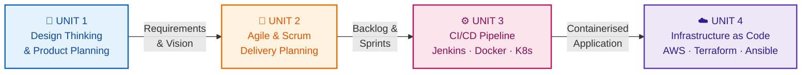

| Unit | Theme | Key Outcome | Primary Tools |
| :---: | --- | --- | --- |
| **1** | Design Thinking & Product Planning | Personas, FRS/NFRS, MVP, 7-phase roadmap | IBM Design Thinking, IBM Loop |
| **2** | Agile Methodology | 7 epics, 8 user stories, backlog, 3 sprints, Scrum board | Scrum, Planning Poker |
| **3** | CI/CD & Orchestration | Passing pipeline, Docker image, 3-replica K8s deployment | Flask, Jenkins, Docker, Minikube |
| **4** | Infrastructure Automation | 11 AWS resources provisioned and destroyed via code | AWS CLI, Terraform, Ansible |

### End-to-End DevOps Lifecycle Covered

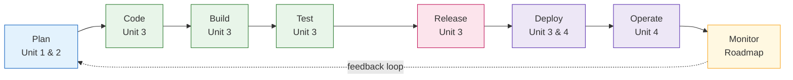

---

# 📐 Unit 1: Design Thinking & Product Planning

> *Focus: understand the problem before writing a single line of code.*

### 1.1 Objective

Document the design thinking, requirement engineering and product planning for a cloud-native academic platform that replaces fragmented, paper-based record management. This unit deliberately focuses on domain understanding, stakeholder personas, functional and non-functional requirements, and repository initialisation.

### 1.2 Programming vs Software Product Engineering

Writing syntax is only about **~20%** of the total effort in a real product lifecycle.

| Dimension | Programming / Coding | Software Product Engineering |
| --- | --- | --- |
| **Primary goal** | Translate logic into executable code | Build scalable, maintainable, valuable systems |
| **Scope** | Functions, micro-tasks, single scripts | Full SDLC, architecture, CI/CD, schemas, security |
| **Success metric** | Code compiles and passes basic inputs | User adoption, availability, performance, business outcome |
| **Mindset** | *"How do I write this function?"* | *"What problem are we solving for users?"* |

### 1.3 Manual Bottlenecks → Automated Solutions

| Manual Bottleneck | Automated Solution | Business Outcome |
| --- | --- | --- |
| Paper attendance registers | Biometric / QR attendance logging | Processing time ↓ **85%** |
| Ledger lookups for GPA & results | Automated grading engine on a relational DB | Result cycle from 2 weeks to **instant** |
| Paper slips for course registration | Self-service portal with live seat validation | Queues eliminated, **100% digital** |
| Lost records, tampering risk | RBAC, encryption, audit logging | Record integrity **99.99%** |

### 1.4 Design Thinking Process

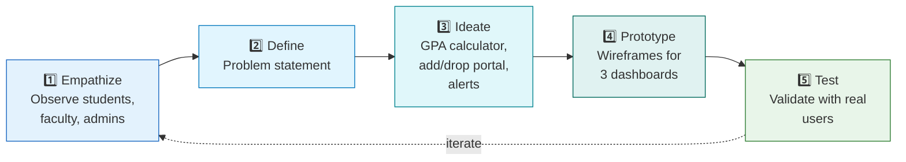

**Problem statement:** *"Academic stakeholders suffer severe operational delays, data errors, and lack of real-time visibility due to fragmented manual record management."*

### 1.5 IBM Design Thinking & the IBM Loop

| Principle | Meaning in this project |
| --- | --- |
| **Focus on user outcomes** | Students can register for courses in under 3 clicks |
| **Restless reinvention** | Continuous deployment as an ongoing refinement cycle driven by usage logs |
| **Diverse empowered teams** | Product Managers, UX Designers, DevOps Engineers and Architects collaborate |

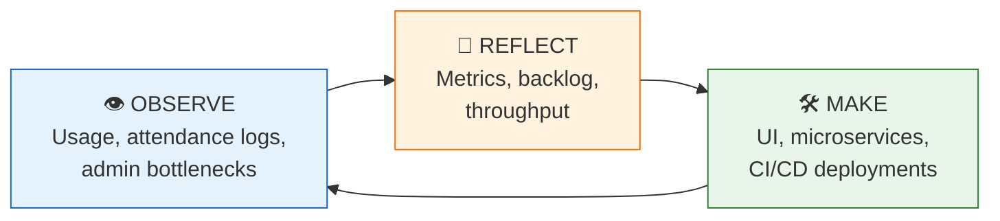

### 1.6 Stakeholder Personas

| Persona | Objectives | Pain Points | Target Feature |
| --- | --- | --- | --- |
| 🧑‍🎓 **Rohan** (Student) | Quick course registration; track GPA and attendance | Long queues, delayed results, lost attendance records | Mobile-responsive portal, instant transcripts, push alerts |
| 👨‍🏫 **Prof. Kulkarni** (Faculty) | Submit grades efficiently; monitor attendance | Manual grade entry, calculation errors | Bulk grade upload, attendance dashboard |
| 🧑‍💼 **Dr. Joshi** (Admin) | Maintain compliant records; institutional reports | Data silos, manual audits taking days | Analytics dashboard, 1-click PDF export, RBAC |

### 1.7 Requirements Specification

**Functional Requirements**

| ID | Requirement | Description |
| --- | --- | --- |
| FR-01 | Authentication & RBAC | Secure login for Admin, Faculty, Student, Examination Cell |
| FR-02 | Student Registration | Onboarding, profile updates, document verification |
| FR-03 | Course Registration | Self-service selection, live seat availability, prerequisite checks |
| FR-04 | Attendance Engine | Daily logging, automated percentage, low-attendance alerts |
| FR-05 | Examination & Results | Grade entry, GPA/CGPA computation, digital transcripts |

**Non-Functional Requirements**

| ID | Category | Target |
| --- | --- | --- |
| NFR-01 | Security | Bcrypt/Argon2 hashing, JWT sessions, TLS 1.3 |
| NFR-02 | Performance | < 500 ms API response at 5,000 concurrent users |
| NFR-03 | Scalability & Availability | Kubernetes, 99.99% uptime, horizontal pod autoscaling |
| NFR-04 | Maintainability | IaC with Terraform/Ansible, modular codebase |

### 1.8 Product Vision, MVP & Roadmap

> **Vision:** *"To deliver a cloud-native, automated, and secure Academic Management Platform that eliminates manual administrative friction, unifies student lifecycle records, and empowers higher education institutions with real-time academic analytics."*

**MVP (Release 1, Sprints 1 to 4):** Student Registration, RBAC Authentication, Course Enrollment, Basic Attendance Logging, Result Generation. AI grade prediction and payment gateways are deferred to Phase 2.

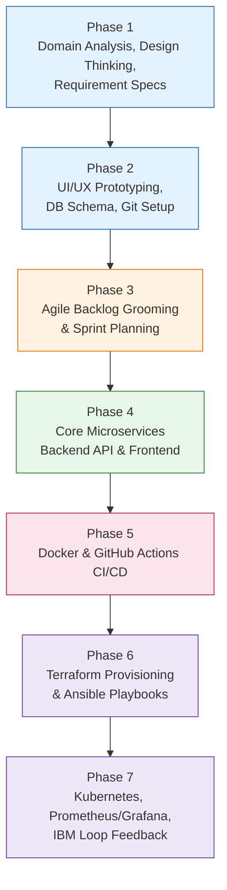

### 1.9 Enterprise Repository Blueprint

```text
Devops_Unit1_MiniProject/
├── .github/        # CI/CD workflows (GitHub Actions)
├── app/
│   ├── modules/    # Business logic (Admissions, Courses, Results)
│   ├── database/   # Schemas, migrations, ORM models
│   └── tests/      # Unit & integration tests
├── docs/           # Architecture diagrams, FRS/NFRS, design specs
├── docker/         # Dockerfiles & Compose configuration
├── kubernetes/     # Deployments, Services, Ingress
├── terraform/      # Cloud provisioning scripts (AWS/Azure)
├── ansible/        # Configuration management playbooks
├── monitoring/     # Prometheus & Grafana dashboards
└── README.md       # Project charter & setup
```

---

# 🔄 Unit 2: Agile & Scrum Methodology

> *Focus: turn the vision into a prioritised, estimable, sprint-ready plan.*

### 2.1 Product Vision & Alignment

> **Agile vision:** *"Develop a secure and user-friendly Student Record and Academic Management Platform that enables educational institutions to efficiently manage student records, attendance, academic performance, course registration, and reporting through a scalable web-based application."*

| Parameter | Details |
| --- | --- |
| **Objective** | Eliminate administrative bottlenecks and manual errors |
| **Primary users** | Students, Faculty, Academic Administrators, IT Engineers |
| **Business benefits** | Administrative overhead ↓ 40%, attendance transparency, no grading delays |
| **Success criteria** | 100% departmental adoption, zero critical vulnerabilities, 95%+ satisfaction |
| **Constraints** | 2-week sprints, zero budget expansion, academic data protection compliance |
| **NFR targets** | 99.9% uptime, search < 2 s, RBAC, end-to-end encryption |

### 2.2 Scrum Team Structure

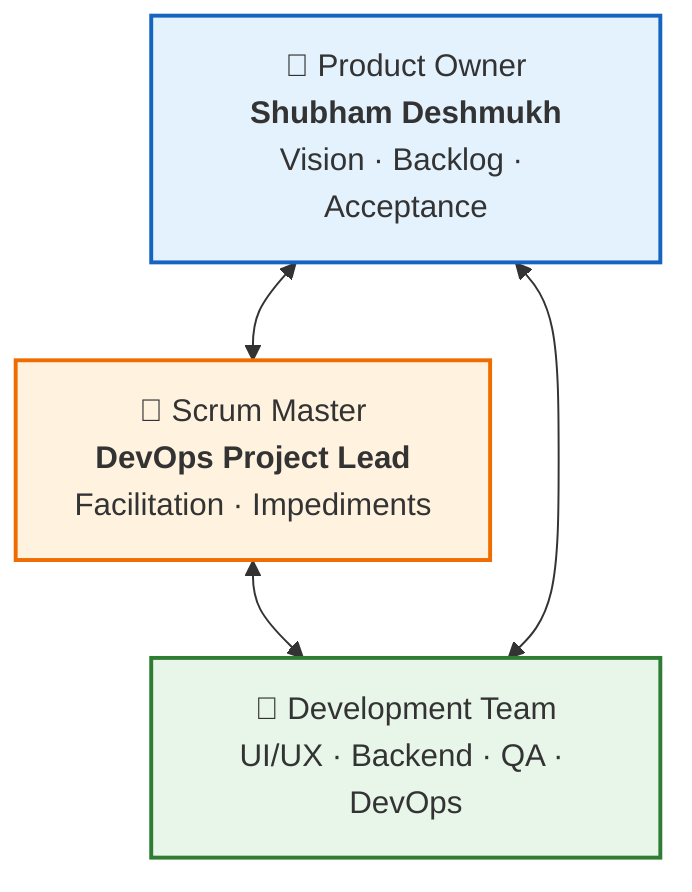

### 2.3 Epics Breakdown

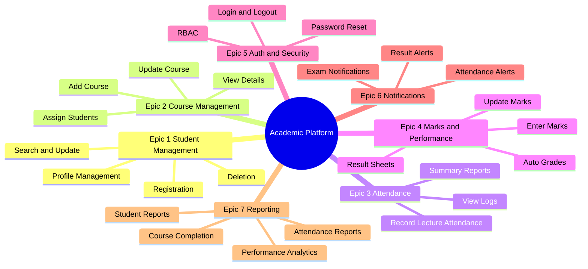

### 2.4 User Stories & Acceptance Criteria

| ID | Epic | User Story | Key Acceptance Criteria |
| :---: | --- | --- | --- |
| **US-01** | Auth & Security | As a **registered user**, I want to log in so that I can access my role-specific dashboard. | Page loads < 1.5 s · role-based redirect · generic error on bad credentials · session expires after 30 min idle |
| **US-02** | Student Mgmt | As an **admin**, I want to register students so that they are enrolled in the database. | Mandatory validation (Email, PRN, DOB, Program) · duplicate PRN/Email rejected · unique Student ID · confirmation email |
| **US-03** | Student Mgmt | As **faculty/admin**, I want to search students so that I can view profiles quickly. | Auto-complete · results < 1 s for 50,000 records · filter by Department, Batch, Status |
| **US-04** | Attendance | As **faculty**, I want to mark attendance so that records stay accurate. | Select course and slot · Present/Absent/Late toggles · instant save with timestamp · downloadable summary |
| **US-05** | Course Mgmt | As a **coordinator**, I want to add courses so that students can register. | Code, Title, Credits, Department, Faculty captured · unique course code · defaults to *Active* |
| **US-06** | Marks | As **faculty**, I want to enter marks so that grades and result sheets are generated. | No negative or over-max marks · weighted grade auto-computed · visual grade distribution |
| **US-07** | Notifications | As a **sysadmin**, I want alerts when attendance < 75% so that intervention is timely. | Weekly automated trigger · in-app and email to student and advisor · audit log entry |
| **US-08** | Reporting | As an **admin**, I want PDF/Excel reports so that records are archived. | Filter by date, department, course · export within 3 s |

### 2.5 Estimation & Prioritised Backlog

**Fibonacci story-point scale (Planning Poker)**

| Points | Complexity | Typical work |
| :---: | --- | --- |
| 1 | Very Easy | Text change or simple lookup |
| 2 | Easy | Form validation, static page |
| 3 | Moderate | Standard CRUD with basic logic |
| 5 | Difficult | Multi-table query, file export, complex form |
| 8 | Very Difficult | Core module, auth integration, complex workflow |
| 13 | Highly Complex | Heavy third-party integration, analytics engine |

**Prioritised Product Backlog**

| Priority | Epic | Story | Points | Sprint |
| :---: | --- | --- | :---: | :---: |
| 🔴 High | Authentication | User Login & Session Management | 5 | 1 |
| 🔴 High | Student Mgmt | Add Student / Registration | 5 | 1 |
| 🔴 High | Student Mgmt | Search Student Directory | 3 | 1 |
| 🔴 High | Attendance | Record Lecture Attendance | 8 | 2 |
| 🔴 High | Course Mgmt | Add & Update Course | 5 | 2 |
| 🟠 Medium | Course Mgmt | Assign Students to Courses | 5 | 2 |
| 🟠 Medium | Marks | Enter Assessment Marks | 8 | 3 |
| 🟠 Medium | Reporting | Attendance & Result Summary Reports | 5 | 3 |
| 🟠 Medium | Notifications | Automated Low-Attendance Alerts | 5 | 3 |
| 🟢 Low | Analytics | Academic Performance Analytics UI | 8 | 4 |

### 2.6 Sprint Plan & Release Roadmap

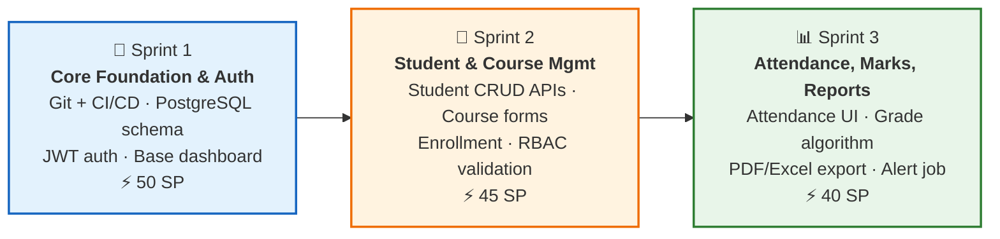

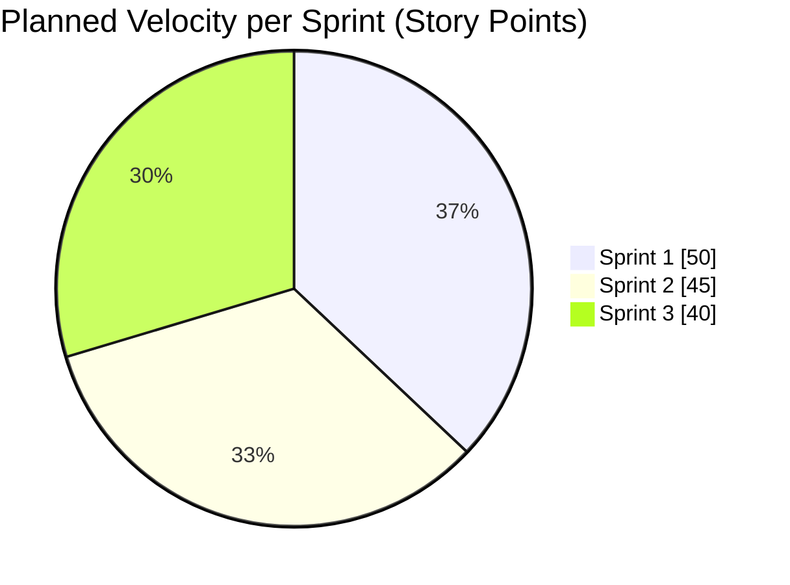

### 2.7 Scrum Board

| 📋 Backlog | 📝 To Do | 🔧 In Progress | 🧪 Testing / QA | ✅ Done |
| --- | --- | --- | --- | --- |
| Academic Analytics | Course Details View | Record Attendance | Search Student API | Project Repo Setup |
| Export Result Sheets | Attendance Alert Job | Add Course Form | Student Profile UI | User Registration |
| Exam Notifications | Update Marks Engine | Assign Students API | DB Schema Migration | User Login / JWT |
| Bulk Student Import | Delete Student Action | Role-Based Access | Auth Unit Tests | CI/CD Pipeline Setup |
| Audit Logging UI | Password Reset | Marks Entry Form | Login Page Layout | Docker Environment |

### 2.8 Scrum Ceremonies

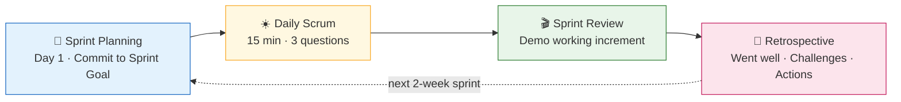

**Daily Scrum questions:** (1) What did I complete yesterday? (2) What will I work on today? (3) What blockers am I facing?

### 2.9 Agile Framework Comparison

| Framework | Focus | Strength | Suitability |
| --- | --- | --- | :---: |
| **Scrum** | 2 to 4 week sprints, defined roles and ceremonies | Predictability, stakeholder feedback | 🟢 **HIGH** |
| **Kanban** | Continuous flow with WIP limits | Flexible priorities, good for support | 🟡 MEDIUM |
| **XP** | TDD, pair programming, CI/CD | High code quality, low defects | 🟢 **HIGH** |
| **Lean** | Waste elimination, value-stream mapping | Efficiency, lean backlog | 🟡 MEDIUM |
| **LeSS** | Multi-team Scrum, single backlog | Scales with one PO | 🔴 LOW |
| **SAFe** | Enterprise PI planning, ARTs | Strategic alignment at scale | 🔴 LOW |
| **Scrum@Scale** | Scrum of Scrums | Linear scaling | 🔴 LOW |

> ✅ **Decision:** **Scrum, augmented with XP practices** (CI/CD, TDD). It balances structured sprint planning, iterative feedback and clear ownership for a single-team project.

---

# ⚙️ Unit 3: CI/CD with Jenkins, Docker & Kubernetes

> *Focus: automate build, test, containerise and orchestrate the application.*

🔗 **Repository:** [shubhamdeshmukh1027/student-academic-platform](https://github.com/shubhamdeshmukh1027/student-academic-platform)

### 3.1 Summary

A **Flask REST API** is developed, linted, tested and built into a Docker image by a **Jenkins declarative pipeline**, then deployed on a **three-replica Kubernetes (Minikube)** cluster.

| Item | Value |
| --- | --- |
| **Application stack** | Python, Flask, Gunicorn, pytest 8.2.1, pytest-cov, flake8 |
| **Automation** | Git/GitHub, Jenkins 2.580.1, Docker, Kubernetes with Minikube v1.39.0 |
| **Environment** | Ubuntu 24.04 on WSL2 (local Python 3.12; image on Python 3.11) |
| **Container image** | `student-academic-platform:v1.0.0` (206 MB) |
| **Service** | NodePort `30090`, 3 replicas |
| **Quality gates** | 14 tests passing · 87% coverage · flake8 clean |
| **Build result** | Build #1 SUCCESS in 54 s |

### 3.2 Repository Structure

```text
student-academic-platform/
├── app/            # routes, services, models
├── database/       # in-memory database with seed data
├── tests/          # pytest unit and API tests
├── k8s/            # deployment.yaml, service.yaml
├── Dockerfile
├── .dockerignore
├── Jenkinsfile
├── requirements.txt
├── run.py
├── .gitignore
└── README.md
```

### 3.3 Application Architecture

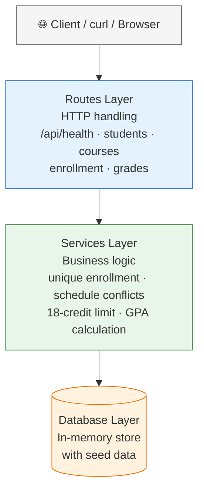

### 3.4 Git Workflow

Each topic lived on its own branch and was merged into `main` through a pull request.

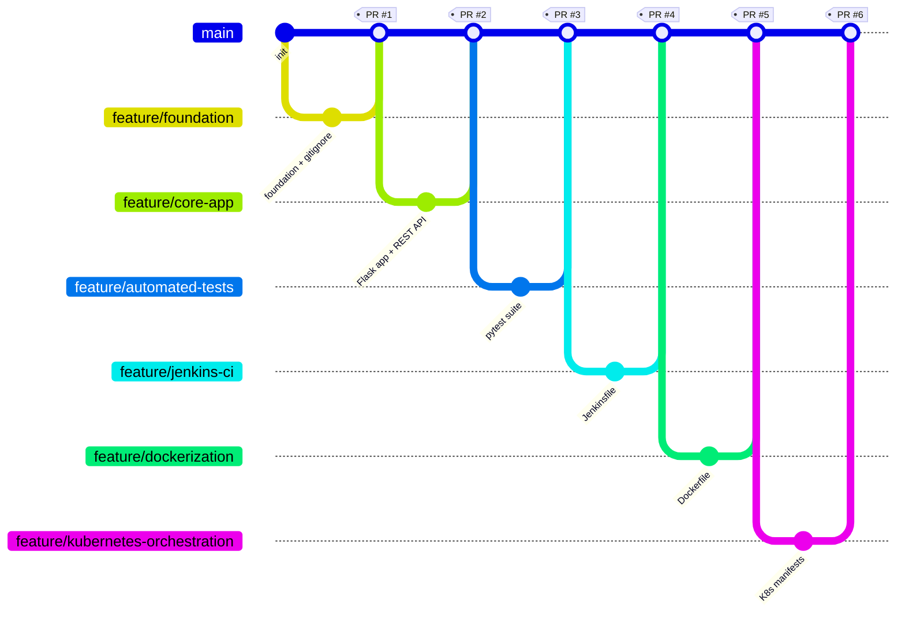

| PR | Branch | Scope |
| :---: | --- | --- |
| #1 | `feature/foundation` | Project foundation, `.gitignore` |
| #2 | `feature/core-app` | Flask app, services, REST API |
| #3 | `feature/automated-tests` | pytest unit and API tests |
| #4 | `feature/jenkins-ci` | Jenkins declarative pipeline |
| #5 | `feature/dockerization` | Dockerfile |
| #6 | `feature/kubernetes-orchestration` | Kubernetes manifests |

### 3.5 Testing & Code Quality

14 tests across three files, all passing at **87% coverage**; flake8 reports **no issues** and is enforced as a pipeline gate.

| Test file | Covers |
| --- | --- |
| `test_api_endpoints.py` | Health, list/create students, enroll and GPA, unknown student → 404 |
| `test_enrollment_gpa.py` | Credit updates, duplicate and schedule-conflict blocking, credit limit, GPA, invalid grade |
| `test_student_service.py` | Add student, duplicate rejected, missing fields rejected |

```bash
pytest -v --cov=app --cov-report=term-missing --junitxml=reports/test-results.xml tests/
```

### 3.6 Jenkins CI Pipeline

Pipeline job `student-platform-pipeline` reads the `Jenkinsfile` from GitHub (*Pipeline script from SCM*).

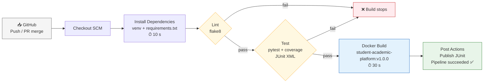

### 3.7 Docker Containerisation

| Dockerfile decision | Detail |
| --- | --- |
| Base image | `python:3.11-slim` |
| Env flags | `PYTHONDONTWRITEBYTECODE`, `PYTHONUNBUFFERED` |
| Security | Runs as non-root user `appuser` |
| Runtime | `gunicorn -w 2 -b 0.0.0.0:5000 run:app` |
| Port | `5000` |

```bash
docker build -t student-academic-platform:v1.0.0 .
docker run -d -p 5000:5000 --name student-container student-academic-platform:v1.0.0
curl http://localhost:5000/api/health
# {"service":"student-academic-platform","status":"UP"}
```

### 3.8 Kubernetes Orchestration (Minikube)

Minikube v1.39.0 with the Docker driver. Because the deployment uses `imagePullPolicy: Never`, the image is built **inside Minikube's Docker daemon**.

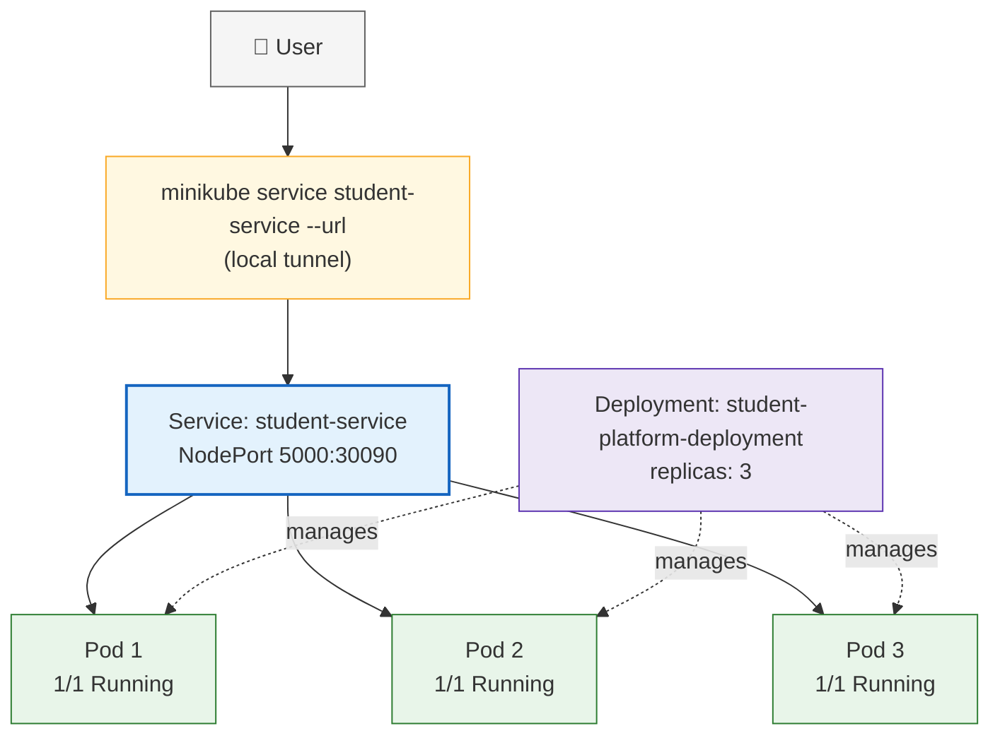

```bash
eval $(minikube docker-env)
docker build -t student-academic-platform:v1.0.0 .
kubectl apply -f k8s/deployment.yaml
kubectl apply -f k8s/service.yaml
```

**Self-healing proof:** a pod was deleted manually and Kubernetes immediately created a replacement, restoring three running replicas without manual action.

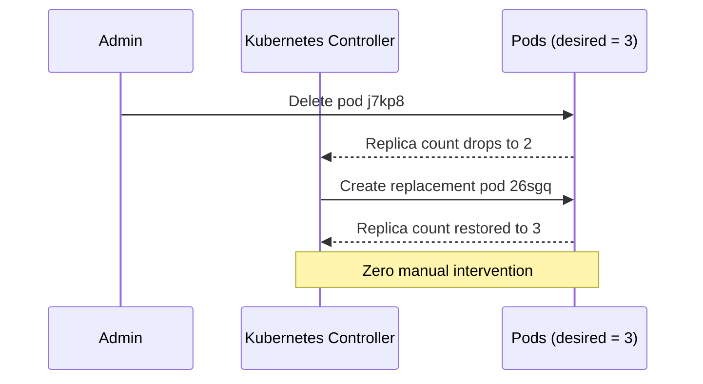

### 3.9 Challenges & Solutions

| Challenge | Cause | Solution |
| --- | --- | --- |
| `curl` failed right after `docker run` | Gunicorn still starting | Waited a few seconds (`sleep 5`) and retried |
| Pods could not find the image | `imagePullPolicy: Never` needs the image inside Minikube | `eval $(minikube docker-env)` and rebuilt there |
| Service URL stopped working | Tunnel closes on interrupt and port changes | Kept `minikube service --url` running in one terminal |
| Shell errors on pasted commands | Placeholders like `<url>` typed literally | Replaced placeholders with real values |

### 3.10 Architectural Reflections

- **Separation of concerns:** routes, services and database are independently testable.
- **Quality gates in CI:** lint, test and build run every time; any failure stops the pipeline.
- **Immutable artifacts:** one tagged, non-root image behaves identically on a laptop, in Jenkins and in Kubernetes.
- **Health as a contract:** `/api/health` serves Docker checks, Kubernetes probes and manual verification.
- **Declarative orchestration:** the Deployment maintains three replicas and the Service gives one stable entry point.

---

# ☁️ Unit 4: Infrastructure Automation (AWS, Terraform, Ansible)

> *Focus: provision and configure cloud infrastructure entirely through code.*

🔗 **Repository:** [shubhamdeshmukh1027/library-platform-devops](https://github.com/shubhamdeshmukh1027/library-platform-devops)

| Item | Value |
| --- | --- |
| **Environment** | Windows 11 + WSL2, Ubuntu 22.04.5 LTS |
| **Cloud region** | AWS `us-east-1` |
| **Lab date** | 11 October 2026 |
| **Chapters covered** | Chapter 2 (Prerequisites & AWS Setup), Chapter 3 (Terraform IaC) |
| **Lab target platform** | Enterprise Smart Library Management Platform |

## 📘 Chapter 2: Prerequisites & AWS Environment Setup

### 4.1 Setup Flow

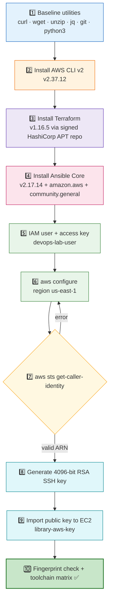

### 4.2 Toolchain Roles

| Tool | Version | Role |
| --- | --- | --- |
| **AWS CLI v2** | 2.37.12 | Manage AWS services and authenticate API sessions |
| **Terraform** | 1.16.5 (min. 1.7) | Declarative IaC for VPC, EC2, S3 and security groups |
| **Ansible Core** | 2.17.14 (min. 2.16) | Agentless configuration over SSH (Docker, Nginx, app launch) |
| **Collections** | `amazon.aws` 8.2.1 · `community.general` 9.5.2 | AWS and general-purpose Ansible modules |

### 4.3 Verification Matrix

| Tool | Verification command | Status |
| --- | --- | :---: |
| AWS CLI v2 | `aws --version` | ✅ Verified |
| AWS Auth | `aws sts get-caller-identity` | ✅ Verified |
| Terraform | `terraform -version` | ✅ Verified |
| Ansible Core | `ansible --version` | ✅ Verified |
| SSH Key Pair | `aws ec2 describe-key-pairs` | ✅ Verified |

> 🔐 **Security governance:** never hardcode AWS keys in Git or `.tf` files. The AWS CLI keeps them in `~/.aws/credentials`, which Terraform detects automatically. The public-key MD5 fingerprint was matched against the AWS `KeyFingerprint` to prove the key pair is correct.

### 4.4 Chapter 2 Troubleshooting

| Symptom | Root cause | Fix |
| --- | --- | --- |
| `aws: command not found` | `/usr/local/bin` missing from PATH | `export PATH=$PATH:/usr/local/bin` and persist in `~/.bashrc` |
| GPG signature verification failed | Outdated CA certs or firewall | `sudo apt-get install --reinstall ca-certificates`, re-fetch key |
| Private key permissions too open | Key is `0644` | `chmod 400 ~/.ssh/library-aws-key` |
| `InvalidAccessKeyId` | Typo or deleted/deactivated key | Create a new key and rerun `aws configure` |

## 🏗️ Chapter 3: Terraform Infrastructure as Code

### 4.5 Terraform Workflow

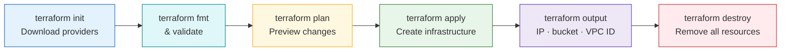

### 4.6 Code Structure

```text
chapter-3/terraform/
├── providers.tf   # Terraform >= 1.7, aws >= 5.0, random >= 3.0, region
├── variables.tf   # region, instance_type, key_name, allowed_ssh_cidr
├── main.tf        # network, security group, EC2, S3
└── outputs.tf     # vpc_id, instance_public_ip, s3_bucket_name
```

### 4.7 Provisioned AWS Architecture

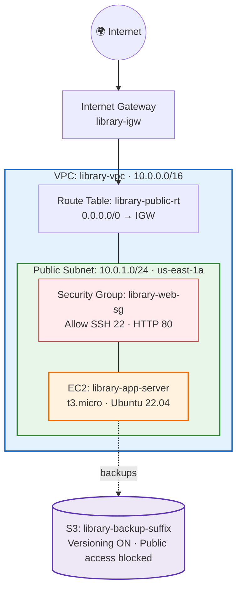

### 4.8 Resources Defined (11 total)

| # | Terraform resource | Purpose |
| :---: | --- | --- |
| 1 | `aws_vpc.main` | `library-vpc`, CIDR 10.0.0.0/16 |
| 2 | `aws_internet_gateway.igw` | Internet access for the VPC |
| 3 | `aws_subnet.public` | 10.0.1.0/24 in us-east-1a |
| 4 | `aws_route_table.public` | Default route 0.0.0.0/0 to the gateway |
| 5 | `aws_route_table_association.public` | Attach route table to subnet |
| 6 | `aws_security_group.web` | Allow SSH (22) and HTTP (80) |
| 7 | `aws_instance.app` | t3.micro, Ubuntu 22.04, key `library-aws-key` |
| 8 | `random_id.suffix` | Globally unique S3 bucket suffix |
| 9 | `aws_s3_bucket.backup` | Backup bucket |
| 10 | `aws_s3_bucket_versioning.backup` | Versioning enabled |
| 11 | `aws_s3_bucket_public_access_block.backup` | All public access blocked |

The Ubuntu 22.04 AMI is resolved via a `data "aws_ami"` source, so **no AMI ID is hardcoded**.

### 4.9 Verification Results

| Check | Result |
| --- | --- |
| `terraform validate` | ✅ Configuration is valid |
| `terraform plan` (rerun) | ✅ No changes, which demonstrates **idempotency** |
| `terraform apply` | ✅ 11 resources created; outputs printed |
| EC2 state (AWS CLI) | ✅ `library-app-server` running, public IP `13.220.44.195` |
| S3 bucket | ✅ `library-backup-cb6cf4e0` |
| SSH login | ✅ Ubuntu 22.04.5 LTS, private IP `10.0.1.246` (inside 10.0.1.0/24) |
| `terraform destroy` | ✅ 11 resources destroyed, no lingering cost |

### 4.10 Git Hygiene for IaC

| ✅ Commit | 🚫 Never commit (blocked by `.gitignore`) |
| --- | --- |
| `main.tf`, `variables.tf`, `providers.tf`, `outputs.tf` | `terraform.tfstate` and `terraform.tfstate.*` |
| `.terraform.lock.hcl` | `.terraform/` directory |
| Masked screenshots | `*.tfvars`, private keys (`*.pem`, `library-aws-key*`) |

> 💰 **Cost note:** EC2 and S3 are billed while they exist. Always run `terraform destroy` after the lab and confirm in the AWS Console that nothing is left behind.

### 4.11 Chapter 3 Troubleshooting

| Symptom | Root cause | Fix |
| --- | --- | --- |
| No valid credential sources found | CLI credentials missing or expired | `aws configure list`, `aws sts get-caller-identity`, rerun `aws configure` |
| `InvalidKeyPair.NotFound` | `key_name` not in region | `aws ec2 describe-key-pairs --region us-east-1` |
| `BucketAlreadyExists` | S3 names are global | Keep the `random_id` suffix |
| Error acquiring the state lock | Another Terraform run active | Wait or stop the old process |
| Plan shows 11 to add again | State file lost | Keep `terraform.tfstate` locally (not in Git) until destroy |

### 4.12 What Comes Next: Ansible

The EC2 instance created by Terraform is the target that **Ansible** configures next: installing Docker and Nginx and launching the application over SSH.

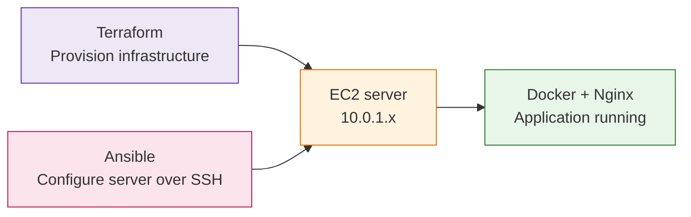

---

## 🧰 Consolidated Technology Stack

| Layer | Technologies |
| --- | --- |
| **Planning & Design** | IBM Design Thinking, IBM Loop, Personas, FRS/NFRS |
| **Agile** | Scrum, XP practices, Planning Poker, Scrum Board |
| **Application** | Python 3.11/3.12, Flask, Gunicorn |
| **Quality** | pytest 8.2.1, pytest-cov, flake8, JUnit reports |
| **Version control** | Git, GitHub, feature-branch + pull-request workflow |
| **CI/CD** | Jenkins 2.580.1 (declarative pipeline), Java 17 |
| **Containers** | Docker (`python:3.11-slim`, non-root user) |
| **Orchestration** | Kubernetes, Minikube v1.39.0, kubectl |
| **Cloud** | AWS (VPC, EC2, S3, IAM, STS), region `us-east-1` |
| **IaC & Config Mgmt** | Terraform 1.16.5, Ansible Core 2.17.14, AWS CLI 2.37.12 |
| **Planned (roadmap)** | GitHub Actions, Prometheus, Grafana, PostgreSQL |

---

## ✅ Master Deliverables Checklist

| Unit | Deliverable | Status |
| :---: | --- | :---: |
| 1 | Design Thinking, personas, FRS/NFRS, MVP, 7-phase roadmap, repo blueprint | ✅ |
| 2 | Vision, Scrum roles, 7 epics, 8 user stories, backlog with story points | ✅ |
| 2 | Sprint plan (3 sprints), Scrum board, ceremonies, framework comparison | ✅ |
| 3 | GitHub repository with 6 merged pull requests | ✅ |
| 3 | Jenkins pipeline (SUCCESS) with JUnit report, 14 tests, 87% coverage | ✅ |
| 3 | Docker image, running container and health check | ✅ |
| 3 | Kubernetes: 3 replicas, self-healing proof, NodePort access | ✅ |
| 4 | Toolchain installed: AWS CLI, Terraform, Ansible; IAM, STS, SSH key verified | ✅ |
| 4 | Terraform IaC: init, validate, plan, apply, verify, destroy (11 resources) | ✅ |

---

## ⚠️ Known Limitations & Future Scope

| Area | Current limitation | Recommended improvement |
| --- | --- | --- |
| **Database (Unit 3)** | In-memory DB resets on restart and is not shared between replicas | Use a persistent external database such as PostgreSQL |
| **Registry (Unit 3)** | Image built locally inside Minikube | Push to Docker Hub / ECR and deploy from a registry |
| **SSH exposure (Unit 4)** | `allowed_ssh_cidr` defaults to `0.0.0.0/0` | Restrict to your own IP range |
| **IAM privileges (Unit 4)** | `AdministratorAccess` used for the lab user | Apply least-privilege policies (EC2, VPC, S3 only) |
| **Terraform state (Unit 4)** | Local state file | Move to a remote backend (S3 + DynamoDB locking) |
| **Monitoring** | Planned in roadmap, not yet implemented | Add Prometheus and Grafana dashboards |
| **Unification** | Unit 4 lab uses the Library platform as target | Apply the Terraform and Ansible code to the Student platform image from Unit 3 |

---

## 🔗 Repositories & Author

| Unit | Repository |
| :---: | --- |
| 3 | https://github.com/shubhamdeshmukh1027/student-academic-platform |
| 4 | https://github.com/shubhamdeshmukh1027/library-platform-devops |

<div align="center">

**Shubham Vijay Deshmukh**
PRN `2125UDSM1027` · AI & Data Science
Careertiq Training & Engineering Division · Cloud DevOps Engineering Series

*Built with ☕, Git commits and a lot of `kubectl get pods`.*

</div>
